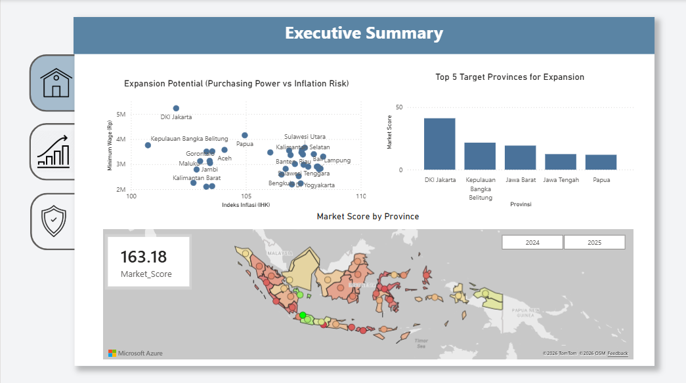

# Identifying Indonesia's Most Promising Markets Through Data-Driven Purchasing Power and Inflation Trends 📊

> *"Great expansion is not about where people are, but where value and stability meet."*

## 📌 Project Overview
Expansion plans often follow population size, but a large market with weak purchasing power or rising prices can leave a business with thin margins. This Business Intelligence project focuses on making the complex simple by transforming regional macroeconomic statistics into a practical dashboard. 

It evaluates where wages are strong, where price pressure is low, and where risk is building to help executive management make data-driven decisions on new branch expansions.

**[👉 Click here to view the PDF version of this dashboard](link-to-your-pdf-file.pdf)**

## 🎯 Key Objectives
1. **Find Expansion Sweet Spots:** Balance purchasing power against cost risks.
2. **Compare Volume and Wealth:** Look beyond simple population metrics.
3. **Flag Cost Risks Early:** Highlight provinces with volatile inflation trends.
4. **Track Monthly Price Trends:** Understand seasonal cost behaviors for better launch timing.
5. **Automate Interactive Reporting:** Build a dynamic tool that adapts to different years (2024 vs. 2025).

---

## 📸 Dashboard Previews

### 1. Executive Summary
*Provides a helicopter view of the top target provinces based on the Market Score, highlighting the balance between purchasing power and inflation risks.*

### 2. Market Size & Income
*Analyzes market volume by comparing population distribution against minimum wage capacity.*

### 3. Risk Assessment (Inflation & Cost Risks)
*A risk mitigation matrix dissecting monthly price index dynamics and highlighting provinces operating in the highest pressure zones.*

---

## 💡 A Practical Expansion Playbook (Key Insights)
Based on the dashboard's analysis, here is the strategic playbook for regional expansion:

* **The Core Value Market (DKI Jakarta):** Jakarta is the clearest sweet spot. Despite holding only 3.8% of the population, it offers the highest minimum wage (~Rp 5.2M) and low price pressure (106.85 in 2025). Its value comes from spending power, not volume, making it the most consistent performer across both years.
* **The Volume Markets (Java):** Jawa Barat, Jawa Timur, and Jawa Tengah hold nearly 46% of the population. Their massive scale is attractive, but with minimum wages sitting near the bottom (~Rp 2.1M in Jawa Barat), they are best suited for scale-driven, mass-market business models.
* **Niche & Premium Markets (Papua & Kepulauan Bangka Belitung):** Both provinces pair strong wages (~Rp 4.2M and ~Rp 3.8M) with very low price pressure (~105.5). Their smaller populations make them ideal for niche or premium market entries.
* **The Watchlist / Danger Zone:** Provinces such as **Maluku Utara** and **Sulawesi Tengah** demonstrate the highest price pressure. It is highly recommended to monitor these regions closely and adjust operating cost budgets before executing physical expansions.
* **Seasonality & Timing:** The monthly line chart reveals that prices consistently peak at year-end (December). A business planning to enter a new province should anticipate higher operating costs toward Q4 and adjust its budget and launch schedule accordingly.

---

## 🛠️ Data Pipeline & Technical Methodology
1. **Data Sourcing:** Integrated provincial price index (CPI), minimum wage, and population data spanning 2024 and 2025.
2. **Data Transformation (Power Query):** 
   - Standardized data types across all datasets.
   - Performed Feature Engineering by creating a Month Index column (utilized with the *Sort by Column* feature) to ensure chronological time-series plotting (January to December) without circular dependencies.
3. **Data Modeling (DAX & Power BI):** 
   - Architected an efficient **Star Schema** utilizing a main Fact Table and a Province Dimension table.
   - Authored dynamic DAX measures (e.g., `Avg_Inflation`, `Market_Score`) to feed interactive visuals.

---

## 🚧 Limitations & Next Steps
To provide a transparent view of the data's boundaries, the following limitations are acknowledged:
* **Metric Constraints:** The wage data reflects the provincial *minimum wage*, not the average regional income. Additionally, the price index is relative to the 2022 baseline, rather than measuring absolute cost of living.
* **Scoring Model:** The `Market_Score` formula utilizes assumed weights that require further validation from business stakeholders.
* **Next Steps:** Future iterations of this dashboard will aim to incorporate Year-on-Year (YoY) inflation rates, sector-level demand, and company-specific operational cost data.

---

## 📂 How to Open the Project File (.pbix)
For recruiters or data professionals who wish to explore the data model, Star Schema, and DAX formulations:
1. Download the `Market_Expansion_Dashboard.pbix` file from this repository.
2. Open the file using **[Microsoft Power BI Desktop](https://powerbi.microsoft.com/desktop/)**.

---
### 🤝 Let's Connect & Collaborate
**Daniel Lincoln Ginting**  
*Making the complex simple.*

📧 Email: daniellincolnginting05@gmail.com  
💼 LinkedIn: [linkedin.com/in/daniellincolnginting](https://linkedin.com/in/daniellincolnginting/)
